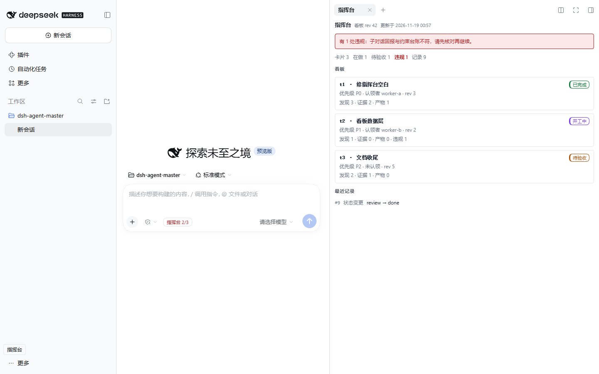

# dsh-agent-master

一条 **master 对话**指挥多路**子对话**（不是子 agent 调用树，是带持久会话的子对话），并把 agent 之间的信息磨损压到最低。

## 它解决什么

多 agent 协作最大的损耗不是算力，是**交接时的信息失真**：摘要会软化硬指令、丢边界、丢"这些事实该怎么用"。本项目对着这个问题做三件事：

1. **约束台账（ledger）** —— 目标/约束/验收/边界/禁止项单独 append-only 存放，**永不进摘要**，每次派活与回收都逐条核对。依据：压缩会让硬指令保留率掉到五成量级。
2. **共享看板（board）** —— master 与所有子对话共读`board.json`：卡片（可改，带 rev 乐观锁）承载状态与归属，证据流（append-only）承载发现/来源/产物/待答问题。卡状态机 `todo → assigned → doing → review → done`（另有 `blocked`），子对话开工第一件事是认领卡片。
3. **结构化交接（handoff）** —— 子对话结束前必须回传固定 schema 的报告；大结果落盘成 artifact，上下文里只留路径 + sha256 + 摘要（digest/locator）。

外加一个**指挥台**：右侧栏面板按卡显示六种状态（各有独立配色）、认领者、P 级与计数，带最近记录与违规提示；点卡片直接打开那一路子对话插话。

## 指挥台怎么用

三个入口，打开的是同一个面板：

1. **会话里**：输入框左侧的「指挥台 N/M」胶囊（N = 未结案卡数，M = 总卡数；变红表示有违规待处理，悬停能看全含义）——打开的是**这个会话**的看板。
2. **左栏底部**：「指挥台」——打开当前会话的看板页签。
3. **面板里点任意卡片** → 右侧栏直接打开那一路子对话，可以插话。

数据来自宿主写在工作区的快照 `.agent-master/<会话号>/deck.json`：面板订阅这个文件的变化，宿主没提供文件监听时自动退回轮询，所以看板更新不用刷新页面。

> 面板一开后空白说明客户端没挂上：先看浏览器控制台，最常见的是插件的 `exports.inject` 少声明了 `remote.workspaceFiles`（见 `PROGRESS.md` §5.7）。

## 七个模型工具

| 工具 | 谁用 | 干什么 |
|---|---|---|
| `master_assign` | master | 把一路任务下派：看板建卡 → 写台账 → 渲染契约 prompt → 开子会话。失败回滚卡，可用同一 taskId 重试。可选 `tools` 给子对话限定工具白名单 |
| `master_dispatch` | master | 批量派发 N 路，**整批只弹一次审批**；被拒则一张卡都不建、一个子会话都不开。任一路 spawn 失败回滚本批新建的卡 |
| `master_report` | 子对话 | 回传结构化报告（校验失败一个字节都不写）；成功写 finding/source/artifact 并跑台账核对。`final:true` 才把卡推到 `review` 等验收 |
| `master_collect` | master | 按卡分组回收（状态/认领者/P 级/摘要/违规），列缺失；并聚合来源（同一 URL 多段引文标为**冲突待核**，不替你判断哪条对） |
| `master_board` | 两者 | 看板读写：query/get/head/records/create/claim/doing/block/reopen/accept。子对话只能动自己名下的卡；`accept/create/reopen` 只有 master 能做 |
| `master_digest` | 两者 | 超预算文本落盘 + 只回摘要与 locator |
| `master_experience` | master | 经验库读写：验收时把教训写进项目级 `experience.jsonl`（或 `scope:global` 写用户级），下次派活前可检索 |

### 派发前的人批准

`master_assign` / `master_dispatch` 在`tools/pre-execute` 门禁里向宿主 approval 服务要一次人批准：路由与目标先渲染成人能读的卡片（`displayReason`），批准才开子会话；被拒/取消/服务缺失一律**不执行**（fail-closed），并告诉模型怎么重试。

## Master 会话

插件加载后会为**当前工作区**自动准备一条 master 会话（每个工作区一条，重启复用同一条）：

- **cwd 就是工作区根目录**，所以它管的是整个工作区，子对话也默认继承这个目录。
- **自动置顶**：走宿主的 `workspaceRegistry.pinSession()`，在左栏会话列表里排在未置顶会话之前。
- **标题固定为 `Master`**（可用 `masterTitle` 改），靠 `sessionTitle.rename()` 写入。
- **工具白名单**：默认只有 7 个 master 工具 + `read` / `write` / `edit` / `ask_user_question`，**没有终端**。白名单在 agent 发布前用 `tools.restrict({ allow })` 钉死，冷恢复（resume）时也会重新挂上。
- 记录落在 `<dataDir>/masters/master-<工作区路径哈希>.json`；删掉文件即让该工作区下次启动重新生成 master。

### 子对话也能按任务限工具

`master_assign` 的 `tools` 参数给这一路子对话指定可见工具（例如只给 `["read","write","pwsh"]`），会自动补上 `master_report` 与 `master_board` 保证交接与查板可用：

    master_assign({
      label: "票据1",
      brief: { goal: "完成票 1", acceptance: ["npm test 全绿"] },
      tools: ["read", "write", "pwsh"],
    })

结果里 `tools` 字段回显实际生效的白名单；省略该参数表示不限制（交回宿主默认工具集）。

## 安装（本地 link，免发布）

1. 在 `%USERPROFILE%\.dsh\profiles\desktop\package.json` 的 `dependencies` 加：

       "dsh-agent-master": "link:D:/Agent Workspace/dsh-agent-master"

2. 同文件 `dsh.profile.bundles` 数组追加 `"dsh-agent-master"`。
3. 安装依赖（pnpm）后**重启 DSH**。

> 本机工具链在 `D:\Agent Workspace\toolchains`（Node/Git/Python），已写入用户 PATH，但**已运行的 DSH 看不到新 PATH**，需要重启。

## 配置

| 键 | 默认 | 含义 |
|---|---|---|
| `maxChildren` | 4 | 同一 root 下最多几路子对话 |
| `maxParallelSearch` | 4 | 并行联网搜索上限 |
| `maxCards` | 32 | 看板卡片上限，超限拒绝建卡（不静默丢弃） |
| `boardMaxEntries` | 256 | 看板证据流记录上限，超限拒绝写入 |
| `approvalWaitMs` | 600000 | 派发审批最多等人多久（毫秒）；超时按拒绝处理 |
| `digestBudgetBytes` | 65536 | digest 落盘阈值 |
| `maxReportBytes` | 8192 | 单份报告字节预算（UTF-8） |
| `defaultEnabled` | false | 新会话默认是否启用 |
| `masterEnabled` | true | 是否自动创建并置顶 master 会话 |
| `masterTitle` | `Master` | master 会话在左栏的标题 |
| `masterTools` | null | master 的工具白名单；null = 默认 11 个（7 master + read/write/edit/ask_user_question） |
| `childToolExtras` | null | 子对话在 `tools` 之外自动补的工具；null = `["master_report","master_board"]` |
| `dataDir` | `$DSH_HOME/agent-master` | 看板/台账/artifacts 根目录 |

未知键在**加载期**报错，不会静默忽略。

## 数据落盘

    <dataDir>/<rootSessionId>/
      board.json       看板：{cards[], records[]}（原子覆盖 + 进程内串行；卡带 rev 乐观锁）
      board.jsonl      旧看板（只在迁移前存在；首次加载自动迁移并留备份）
      board.jsonl.bak-<时间戳>   迁移前的逐字节备份
      ledger.jsonl     约束台账（append-only，版本递增，改旧版会报错）
      artifacts/       digest 产物（<sha256>.md）

    <dataDir>/masters/
      master-<hash>.json  每个工作区的 master 会话 id 与标题（删掉即重置）

    <root 会话 cwd>/.agent-master/<rootSessionId>/
      deck.json        指挥台快照 v2（原子覆盖；客户端经官方 workspaceFiles Remote 读取/监听）
                       {version:2, revision, cards[{id,label,status,priority,rev,assignee,counts}], counts, recent[]}

    <root 会话 cwd>/.agent-master/experience.jsonl   项目级经验（append-only，读时折叠；优先级高于用户级）
    ~/.dsh/agent-master/experience.jsonl             用户级经验（scope:global 写入）

指挥台**不写会话事件**：宿主读档只接受已知事件类型或带 `ignorable: true` 的信封，
而线上 `Session.append()` 设不了该标记 —— 写自定义事件会让整个会话下次打不开。
历史会话里的 `agent-master/deck` 事件仍由会话投影 `agentMaster` 折叠，作为快照缺失时的回退。

删掉某个 root 的目录即彻底清理该会话的协作状态。

## 已知限制

- 提示词体积：master 纪律段约 3.2 KB（只注入 root 会话），子对话段约 1.5 KB。为省几百字节重写已审措辞，收益不抵风险，暂不压缩。
- `chooseDispatch`（五档派发阶梯）目前只是**库函数 + 提示词纪律**，尚未被工具层强制调用；要不要升级成硬闸门另议。
- 来源冲突判定只比较引文**文本**，不做语义判断（有意为之：不替你做事实裁决）。

- 看板只有**进程内**串行队列 + CAS；跨进程共写同一 root 没有文件锁。
- 旧契约（v1）的 deck 快照一律显示占位提示，不做半截渲染（数据在盘上，重新派发一次即写出 v2）。
- 派发审批的等待时长为**插件自驱动**（宿主 approval 服务没有 timeout 参数）：`approvalWaitMs` 到点即取消并向宿主发 abort，结果按拒绝处理。宿主若改成自带超时，这层可退化为纯透传。
- 客户端面板无 DOM 测试，真机视觉需在 DSH 里目视确认。
- 指挥台快照落在工作区 `.agent-master/`（客户端按会话工作区相对路径发现它）；不想入库就加进 `.gitignore`。
- 客户端读/监听快照走官方 `workspaceFiles` Remote；离线单测用假 Remote 覆盖了路径、解析与帧处理，**真机 `changes` 流未验证**（重启后按 `docs/e2e-checklist.md` 勾）。
- 本机 `%TEMP%` 对沙箱进程不可写，测试一律走仓内 `.test-tmp`；`node --test` 在 confined 模式下会因管道 spawn 报 EPERM，测试入口已改成逐文件 `node <file>`。
- master 会话的工具限制依赖宿主 `tools.restrict()`（只能挂在 agent 作用域）。宿主若移除此 API，白名单退化为不生效并记一条诊断，不会让插件加载失败。

## 回滚

从 `dsh.profile.bundles` 移除 `dsh-agent-master` 并重启 DSH 即恢复；`$DSH_HOME/agent-master` 留存不影响启动。